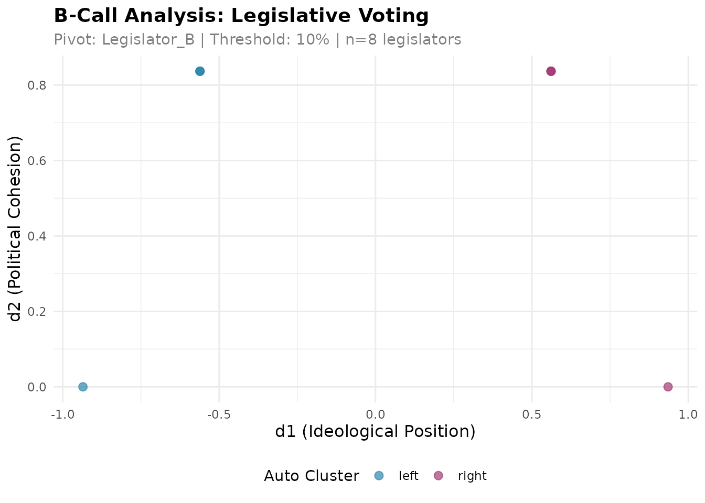
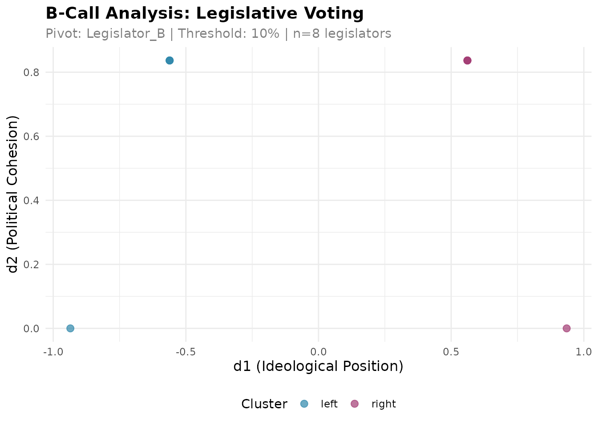

# Introduction to B-Call Analysis

## What is B-Call?

B-Call is a methodology for analyzing legislative voting data that
integrates two key dimensions:

- **d1 (Ideological Position)**: Measures the left-right political
  spectrum position of each legislator
- **d2 (Political Cohesion)**: Measures how consistently a legislator
  votes with their ideological bloc

Unlike traditional methods that only capture ideological position,
B-Call provides a richer understanding of legislative behavior by
simultaneously measuring both ideology and voting discipline.

## Citation

If you use this package in your research, please cite:

> Toro-Maureira S, Reutter J, Valenzuela L, Alcatruz D and Valenzuela M
> (2025). B-Call: integrating ideological position and voting cohesion
> in legislative behavior. *Frontiers in Political Science* 7:1670089.
> [doi:10.3389/fpos.2025.1670089](https://doi.org/10.3389/fpos.2025.1670089)

## Installation

``` r

# Install from GitHub
devtools::install_github("bcallr/bcall")
```

``` r

library(bcall)
```

## Two Principles of B-Call

The `bcall` package implements two main approaches:

### Principle 1: Automatic Clustering

Use
[`bcall_auto()`](https://alcatruz.github.io/bcall/reference/bcall_auto.md)
when you only have rollcall voting data. The function automatically
clusters legislators into two groups based on their voting patterns.

### Principle 2: User-Provided Clustering

Use [`bcall()`](https://alcatruz.github.io/bcall/reference/bcall.md)
when you have external information about legislator groupings (e.g.,
party affiliation, coalition membership). You provide both the rollcall
data and the clustering assignment.

## Data Format Requirements

### Rollcall Data

Your rollcall data must be a `data.frame` with:

- **Legislators as rows** (with rownames)
- **Votes as columns** (any column names)
- **Values**: `1` (Yes), `-1` (No), `0` (Abstention), `NA` (Absent)

Example:

``` r

rollcall <- data.frame(
  vote_1 = c(1, -1, 1, -1, 1, -1, 1, -1),
  vote_2 = c(1, -1, 1, -1, 1, -1, 1, -1),
  vote_3 = c(-1, 1, -1, 1, -1, 1, -1, 1),
  vote_4 = c(1, 1, -1, -1, 1, 1, -1, -1),
  vote_5 = c(1, -1, 1, 1, -1, -1, 1, -1),
  row.names = paste0("Legislator_", LETTERS[1:8])
)

head(rollcall)
#>              vote_1 vote_2 vote_3 vote_4 vote_5
#> Legislator_A      1      1     -1      1      1
#> Legislator_B     -1     -1      1      1     -1
#> Legislator_C      1      1     -1     -1      1
#> Legislator_D     -1     -1      1     -1      1
#> Legislator_E      1      1     -1      1     -1
#> Legislator_F     -1     -1      1      1     -1
```

### Clustering Data (Principle 2 only)

For [`bcall()`](https://alcatruz.github.io/bcall/reference/bcall.md),
you also need clustering data:

- A `data.frame` with exactly one column named `cluster`
- Rownames matching the rollcall data
- Exactly 2 unique values (can be any labels: “left”/“right”,
  “government”/“opposition”, etc.)

``` r

clustering <- data.frame(
  cluster = c("left", "right", "left", "right",
              "left", "right", "left", "right"),
  row.names = paste0("Legislator_", LETTERS[1:8])
)

head(clustering)
#>              cluster
#> Legislator_A    left
#> Legislator_B   right
#> Legislator_C    left
#> Legislator_D   right
#> Legislator_E    left
#> Legislator_F   right
```

## Example 1: Automatic Clustering

Let’s analyze our sample rollcall data using automatic clustering:

``` r

# Run automatic clustering analysis
results_auto <- bcall_auto(
  rollcall = rollcall,
  distance_method = 1,  # 1 = Manhattan, 2 = Euclidean
  pivot = "Legislator_B",  # Reference legislator; their side of d1 is positive
  threshold = 0.1,      # Minimum 10% participation
  verbose = FALSE
)

# View results
head(results_auto$results)
#>                      d1      d2   legislator auto_cluster
#> Legislator_A -0.9354143 0.00000 Legislator_A         left
#> Legislator_B  0.5612486 0.83666 Legislator_B        right
#> Legislator_C -0.5612486 0.83666 Legislator_C         left
#> Legislator_D  0.5612486 0.83666 Legislator_D        right
#> Legislator_E -0.5612486 0.83666 Legislator_E         left
#> Legislator_F  0.5612486 0.83666 Legislator_F        right
```

The results contain:

- `d1`: Ideological position (higher values = closer to the pivot’s
  side)
- `d2`: Political cohesion (lower values = more cohesive)
- `auto_cluster`: Automatically assigned cluster
- `legislator`: Legislator name

### Visualizing Results

``` r

# Static plot
plot_bcall_analysis(results_auto)
```



``` r

# Interactive plot (not shown in vignette)
plot_bcall_analysis_interactive(results_auto)
```

## Example 2: User-Provided Clustering

When you have external information about legislator groups:

``` r

# Run analysis with user-defined clustering
results_user <- bcall(
  rollcall = rollcall,
  clustering = clustering,
  pivot = "Legislator_B",  # Reference legislator from "right" cluster
  threshold = 0.1,
  verbose = FALSE
)

# View results
head(results_user$results)
#>                      d1      d2   legislator cluster
#> Legislator_A -0.9354143 0.00000 Legislator_A    left
#> Legislator_B  0.5612486 0.83666 Legislator_B   right
#> Legislator_C -0.5612486 0.83666 Legislator_C    left
#> Legislator_D  0.5612486 0.83666 Legislator_D   right
#> Legislator_E -0.5612486 0.83666 Legislator_E    left
#> Legislator_F  0.5612486 0.83666 Legislator_F   right
```

``` r

# Plot with user clustering
plot_bcall_analysis(results_user)
```



## Understanding the Pivot

The **pivot** is a reference legislator that defines the orientation of
the d1 dimension:

- The pivot’s cluster is labeled as “right”
- The other cluster becomes “left”
- If you don’t specify a pivot in
  [`bcall_auto()`](https://alcatruz.github.io/bcall/reference/bcall_auto.md),
  the cluster that contains the first row of the rollcall is labelled
  “right” and the pivot is taken from it. The sign of d1 is then
  arbitrary, and the function warns about it

**Important**: The pivot doesn’t change the underlying analysis, only
the interpretation. If your d1 values seem inverted, you can either:

1.  Choose a pivot from the opposite cluster, or
2.  Simply interpret d1 values with reversed signs

## Real-World Example: Loading Data from CSV

Here’s how to load and analyze real legislative data:

``` r

library(readr)
library(dplyr)
library(tibble)

# Load rollcall data from CSV
rollcall_data <- read_csv("votes.csv") %>%
  rename(legislator = 1) %>%        # First column is legislator names
  column_to_rownames("legislator")

# Option 1: Automatic clustering
results <- bcall_auto(rollcall_data)

# Option 2: With party information
clustering_data <- read_csv("legislators.csv") %>%
  select(legislator, party) %>%
  mutate(cluster = ifelse(party %in% c("PartyA", "PartyB"),
                          "coalition", "opposition")) %>%
  select(legislator, cluster) %>%
  column_to_rownames("legislator")

results <- bcall(rollcall_data, clustering_data,
                 pivot = "SomeSpecificLegislator")
```

## Interpreting Results

### d1 (Ideological Position)

- **Positive values**: The pivot’s side (right-wing when the pivot is a
  right-wing legislator)
- **Negative values**: The opposite side
- **Magnitude**: Distance from the center

### d2 (Political Cohesion)

- **Low values** (close to 0): High cohesion - votes consistently with
  their bloc
- **High values**: Low cohesion - frequently votes against their bloc

### Example Interpretation

``` r

# Find most extreme positions
res <- results_auto$results

head(res[order(res$d1), ], 3)  # Most left-wing
#>                      d1      d2   legislator auto_cluster
#> Legislator_A -0.9354143 0.00000 Legislator_A         left
#> Legislator_C -0.5612486 0.83666 Legislator_C         left
#> Legislator_E -0.5612486 0.83666 Legislator_E         left

head(res[order(res$d1, decreasing = TRUE), ], 3)  # Most right-wing
#>                     d1      d2   legislator auto_cluster
#> Legislator_H 0.9354143 0.00000 Legislator_H        right
#> Legislator_B 0.5612486 0.83666 Legislator_B        right
#> Legislator_D 0.5612486 0.83666 Legislator_D        right

head(res[order(res$d2), ], 3)  # Most cohesive
#>                      d1      d2   legislator auto_cluster
#> Legislator_A -0.9354143 0.00000 Legislator_A         left
#> Legislator_H  0.9354143 0.00000 Legislator_H        right
#> Legislator_B  0.5612486 0.83666 Legislator_B        right
```

## Parameters

### Common Parameters

- `threshold`: Minimum participation rate (0.0-1.0). Legislators below
  this threshold are excluded.
- `verbose`: Whether to print progress messages (default: TRUE)

### `bcall_auto()` Specific

- `distance_method`: Distance metric for clustering
  - `1` = Manhattan distance (recommended)
  - `2` = Euclidean distance
- `pivot`: Optional, but recommended. If NULL, the pivot is taken from
  the cluster that contains the first row, and the sign of d1 is
  arbitrary.

### `bcall()` Specific

- `clustering`: User-provided clustering assignment
- `pivot`: **Required**. Must be a legislator name from your data

## Advanced: Accessing Components

The results object contains several components:

``` r

# Main results data frame
head(results_auto$results)
#>                      d1      d2   legislator auto_cluster
#> Legislator_A -0.9354143 0.00000 Legislator_A         left
#> Legislator_B  0.5612486 0.83666 Legislator_B        right
#> Legislator_C -0.5612486 0.83666 Legislator_C         left
#> Legislator_D  0.5612486 0.83666 Legislator_D        right
#> Legislator_E -0.5612486 0.83666 Legislator_E         left
#> Legislator_F  0.5612486 0.83666 Legislator_F        right

# Metadata about the analysis
str(results_auto$metadata)
#> List of 11
#>  $ principle             : chr "PRINCIPLE 1: Auto-clustering"
#>  $ clustering_method     : chr "Manhattan"
#>  $ distance_method       : num 1
#>  $ pivot                 : chr "Legislator_B"
#>  $ pivot_participation   : chr "100.0%"
#>  $ threshold             : num 0.1
#>  $ n_legislators_original: int 8
#>  $ n_legislators_analyzed: int 8
#>  $ n_votes               : int 5
#>  $ cluster_distribution  : 'table' int [1:2(1d)] 4 4
#>   ..- attr(*, "dimnames")=List of 1
#>   .. ..$ : chr [1:2] "left" "right"
#>  $ date_analyzed         : Date[1:1], format: "2026-10-28"

# Original BCall R6 object (for advanced users)
class(results_auto$bcall_object)
#> [1] "BCall" "R6"
```

## Tips and Best Practices

1.  **Data Quality**: Ensure your rollcall data has enough votes (\>20)
    and legislators (\>10) for meaningful analysis

2.  **Pivot Selection**: Choose a pivot legislator who:

    - Has high participation (few absences)
    - Represents a clear ideological position
    - Is well-known in the context

3.  **Threshold Setting**:

    - Default 0.1 (10%) works for most cases
    - Increase for higher quality (excludes occasional participants)
    - Decrease to include more legislators

4.  **Clustering Values**: When using
    [`bcall()`](https://alcatruz.github.io/bcall/reference/bcall.md),
    you can use any 2 values for clustering (“A”/“B”,
    “government”/“opposition”, “izquierda”/“derecha”, etc.)

## Getting Help

For more information:

- Package documentation:
  [`?bcall_auto`](https://alcatruz.github.io/bcall/reference/bcall_auto.md),
  [`?bcall`](https://alcatruz.github.io/bcall/reference/bcall.md)
- GitHub repository: <https://github.com/bcallr/bcall>
- Report issues: <https://github.com/bcallr/bcall/issues>

## References

Toro-Maureira, S., Reutter, J., Valenzuela, L., Alcatruz, D., &
Valenzuela, M. (2025). B-Call: integrating ideological position and
voting cohesion in legislative behavior. *Frontiers in Political
Science*, 7, 1670089.
